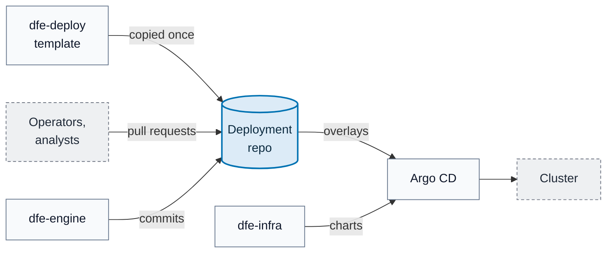

# dfe-deploy documentation

dfe-deploy is the template for a deployment's git repo, the one Argo CD deploys a DFE stack from. Each deployment keeps its copy, and HyperI ships the charts and ApplicationSets separately in dfe-infra.

Operators, analysts and dfe-engine all write to the deployment repo, and Argo CD reads it over dfe-infra's charts to deploy the cluster.

*Figure 1. L1 Context -- Deployment repo. Dashed boxes are outside DFE.* Up: top of dfe-deploy.

The overlays are `values/`, `infra/` and `sizing/`. dfe-infra's charts render at the revision the cluster secret's `dfe.hyperi.io/target_revision` names, and `pins.yaml` records the stack that revision belongs to. dfe-infra's bootstrap creates the bundled Forgejo repo without this template ([dfe-infra#13](https://github.com/hyperi-io/dfe-infra/issues/13) tracks seeding it from the stack's tag), so the template copy is the path for a repo on GitHub, GitLab or any other forge.

- [Architecture](architecture.md): why the repo is split from its base, the values cascade, governed ops and the rules the files do not show.
- [values/](../values/README.md), [infra/](../infra/README.md), [config/](../config/README.md), [governance/](../governance/README.md) and [sizing/](../sizing/README.md): each directory's rules, to read before a first edit.
